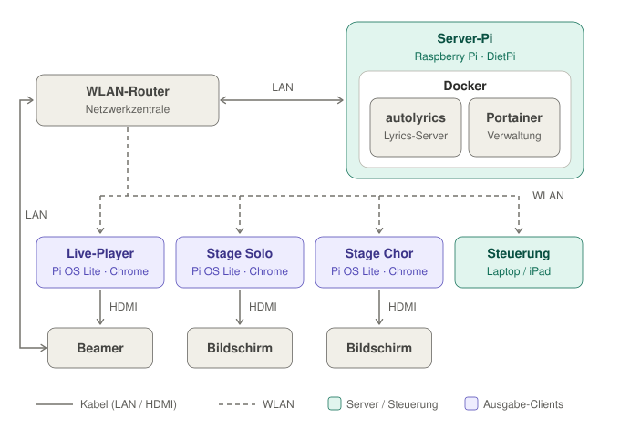

# Autolyrics

**Autolyrics** ist eine webbasierte Anwendung zur Echtzeit-Projektion und Anzeige von Songtexten und Übersetzungen für Live-Events, Chöre, Bands und Gottesdienste. Die Anwendung ermöglicht eine synchrone Steuerung von Songtexten über WebSockets auf mehrere Bildschirme (Projektionen, Bühnen-Monitore/Teleprompter und mobile Endgeräte).

---

## Funktionalität und Ansichten

Autolyrics bietet verschiedene spezialisierte Ansichten, die über das Netzwerk synchronisiert werden:

### 1. Steuerung (`/`)
* **Song-Auswahl & Wiedergabesteuerung**: Start, Pause, Stopp sowie Vor-/Zurückspringen um 5 Sekunden.
* **Live-Vorschau**: Anzeige des aktuellen Songtexts und der verbleibenden Zeit.
* **Direktsprung**: Klick auf eine Songzeile springt sofort zu dieser Position.
* **Player-Verwaltung**: Übersicht aller verbundenen Geräte (Player) mit der Möglichkeit, ihnen dynamisch Rollen zuzuordnen (`Live`, `Stage` oder Unassigned).
* **QR-Codes**: Automatische Generierung von QR-Codes für den schnellen Zugriff von mobilen Geräten aus auf `/player`, `/live` und `/stage`.

### 2. Projektion / Live-View (`/live`)
* **Haupt-Projektionsansicht**: Zeigt die aktuelle Songzeile in großer Schrift sowie die deutsche Übersetzung darunter an.
* **Takt-Pulse (Heartbeat)**: Visueller Indikator (pulsierender Punkt) im Takt der Musik (BPM) für Musiker und Sänger.
* **Automatischer Blackout**: Wenn keine Wiedergabe läuft, der Song zu Ende ist oder die Verbindung zum Server länger als 30 Sekunden unterbrochen wird, schaltet die Anzeige auf Schwarz.
* **Vollbildmodus**: Über Klick oder Button in den Vollbildmodus schaltbar.

### 3. Stage-View / Bühnenanzeige (`/stage`)
* **Teleprompter-Modus für Sänger & Chöre**: Zeigt ausschließlich den Originaltext ohne Übersetzungen an.
* **Dynamischer Kontext**: Zeigt konfigurierbar vergangene und zukünftige Zeilen an (z. B. 2 vergangene, 1 aktuelle, 2 zukünftige Zeilen).
* **Bühnenvorlauf**: Konfigurierbarer Zeitversatz in Sekunden, damit Sänger die nächsten Zeilen vorzeitig sehen.
* **Optische Hervorhebung**: Die aktuelle Zeile wird größer und hervorgehoben dargestellt.

### 4. Player-View (`/player`)
* **Universelle Mobilgeräte-Ansicht**: Jedes Gerät generiert eine eindeutige ID (GUID in `localStorage`).
* **Dynamische Rollenzuweisung**: Unverknüpfte Player zeigen einen Registrierungs-Bildschirm mit ihrer ID. Sobald in der Steuerung eine Rolle zugewiesen wird (`Live` oder `Stage`), wechselt die Anzeige automatisch auf die entsprechende Ansicht.
* **Gerätenamen**: In der Player-Verwaltung kann jedem Gerät ein Name gegeben werden (z. B. „iPad links“), der auch auf dem Registrierungs-Bildschirm des Geräts erscheint.
* **Gerätespezifische Stage-Einstellungen**: In der Player-Verwaltung lassen sich Schriftgrösse, Breite der Kommentarspalte und vertikale Position pro Gerät übersteuern. Nicht angepasste Werte folgen den Grundeinstellungen unter „Einstellungen“.

### 5. Song- & Wellenform-Editor (`/editor`)
* **MP3-Upload & Audio-Verknüpfung**: Hochladen von Audiodateien zur visuellen Ausrichtung der Songzeilen.
* **Interaktiver Wellenform-Editor**:
  * Visuelle Darstellung der MP3-Wellenform mit Takt- und Schlagraster basierend auf der Song-BPM und Taktart.
  * Platzieren und Verschieben von Songzeilen-Markern per Drag & Drop direkt auf der Wellenform.
  * **Verschiebe-Modi**: Verschieben eines einzelnen Markers oder synchrones Verschieben des ausgewählten und aller nachfolgenden Marker.
  * **Audio-Offset**: Anpassung des Audio-Startzeitpunkts (Verschieben der Tonspur relativ zum Songstart).
  * Zoom- und Playback-Steuerung.
* **Flexibles Timing-System**: Zeilen können in verschiedenen Timing-Modi angegeben werden:
  * Absolut in Sekunden
  * Relativ zur vorherigen Zeile (in Sekunden oder Takten/Schlägen)
  * Absolut in Takten und Schlägen (Bar/Beat)
* **JSON / Datei Import & Export**: Sichern und Wiederherstellen der gesamten Songbibliothek durch Datei-Download (`.json`) und Datei-Upload (`.json`, `.txt`) direkt im Browser ohne Notwendigkeit der Zwischenablage.

* **Verschiebe-Modus**: „Nur diese Zeile“ oder „Diese & folgende“ gilt für das Ziehen der Marker auf der Wellenform und für das Ändern von Takt, Schlag oder Sekunden in einer Zeile.
* **Synchronisation zwischen Instanzen**: Unter „Von anderer Instanz synchronisieren“ die Adresse einer anderen Autolyrics-Instanz eingeben (z. B. `http://nas.local:8080`) und verbinden. Die Vorschau zeigt pro Song „Neu“, „Geändert“ oder „Unverändert“; ausgewählte Songs werden übernommen, optional samt MP3-Dateien.
  * Songs mit bekannter ID werden aktualisiert, neue hinzugefügt. Songs, die es nur lokal gibt, bleiben erhalten.
  * Die abholende Instanz muss die andere im Netzwerk erreichen können (aus Sicht des Servers bzw. Docker-Containers, nicht des Browsers). Beide Instanzen brauchen mindestens Version 1.2.
  * Jede Instanz stellt ihr Songpaket unter `GET /api/export` bereit (ohne Anmeldung, wie die übrige Anwendung – nur in vertrauenswürdigen Netzen betreiben).

### 6. Anzeige-Optionen (`/options`)
* Anpassung von Schriftgrößen (Haupttext & Übersetzung).
* Positionierung des Textes (X- und Y-Achse auf dem Bildschirm).
* Aktivierung/Deaktivierung des Heartbeat-Punkts.
* Konfiguration der Stage-View (Anzahl vergangener/zukünftiger Zeilen, Bühnenvorlauf in Sekunden).
* Automatischer Wechsel zum nächsten Song nach dem Songende (ein-/ausschaltbar, mit einstellbarer Wartezeit). Der nächste Song wird gestoppt am Anfang geladen und erscheint so bereits auf der Stage-View. Gilt nur für die Wiedergabe aus der Steuerung, nicht für „Send to screens“ im Song-Editor.
* Optionale Titelzeile mit dem Songtitel auf der Stage-View (halbe Schriftgrösse des Songtexts).

---

## Architektur und Tech-Stack

Die Anwendung ist als Lightweight-Fullstack-Webanwendung aufgebaut:

* **Backend**:
  * **Node.js & Express**: HTTP-Server für statische Dateien, API-Routen (`/api/upload`) und Ansichts-Routing (`/live`, `/stage`, `/player`).
  * **WebSocket (`ws`)**: Bidirektionale Echtzeit-Synchronisation des Wiedergabestatus, der Songdaten und der verbundenen Player.
  * **Datenpersistenz**: Getrennte Speicherung in separaten JSON-Dateien (`data/songs.json`, `data/playback.json`, `data/players.json`), mit automatischer Abwärtskompatibilität zu bestehenden `data/state.json`-Dateien.
  * **Multer**: Handhabung von Audio-Uploads in das Verzeichnis `data/uploads/`.
* **Frontend**:
  * **React 18**: UI-Komponentenbibliothek.
  * **Tailwind CSS**: Utility-First Styling.
  * **Lucide React**: Icon-Set.
  * **HTML5 Canvas & Web Audio API**: Dekodierung von MP3-Dateien und Rendering der Wellenform-Visualisierung.
  * **esbuild**: Schnelles Bündeln des JavaScript-Codes.

### Einsatz-Setup (Hardware & Netzwerk)



* **Server-Pi**: Raspberry Pi mit DietPi und Docker. Darin laufen der autolyrics-Container und Portainer zur Verwaltung. Per LAN am Router angeschlossen.
* **WLAN-Router**: Zentraler Knoten des Netzwerks. Per LAN hängen der Server-Pi und der Beamer daran, alle anderen Geräte per WLAN.
* **Live-Player**: Raspberry Pi mit Raspberry Pi OS Lite und Chrome im Kiosk-Modus, zeigt die Projektion (`/live`) per HDMI auf dem Beamer.
* **Stage-Player Solo und Chor**: Je ein Raspberry Pi mit Raspberry Pi OS Lite und Chrome im Kiosk-Modus, zeigt die Bühnenanzeige (`/stage`) per HDMI auf einem eigenen Bildschirm, einer für den Solo-Sänger und einer für den Chor.
* **Beamer**: Bekommt das Bild per HDMI vom Live-Player und ist zusätzlich per LAN am Router, damit er über das Netzwerk gesteuert werden kann.
* **Steuerung**: Laptop oder iPad im WLAN, bedient autolyrics im Browser.

---

## Projektstruktur

```text
autolyrics/
├── data/                  # Persistente Daten (wird zur Laufzeit erstellt)
│   ├── songs.json         # Gespeicherte Songs
│   ├── playback.json      # Wiedergabestatus & Anzeige-Einstellungen
│   ├── players.json       # Registrierte Endgeräte (Player)
│   └── uploads/           # Hochgeladene MP3-Dateien
├── docs/
│   └── architektur.svg    # Grafik des Einsatz-Setups (Hardware & Netzwerk)
├── public/                # Statische Web-Assets & gebündelter Output
│   ├── bundle.js          # Gebündeltes Frontend-JavaScript
│   ├── index.html         # HTML-Einstiegspunkt
│   └── styles.css         # Gebündeltes Tailwind CSS
├── scripts/
│   └── generate-version.js # Generiert src/version.json und public/version.json
├── server/
│   └── index.js           # Express- und WebSocket-Server
├── shared/                # Von Server und Client gemeinsam genutzt (Standardwerte, Geräte-Einstellungen)
├── src/
│   ├── App.jsx            # Wurzelkomponente: Theme, Routing, Auswahl der Ansicht
│   ├── index.jsx          # React DOM Rendering Einstiegspunkt
│   ├── theme.js           # Farbpaletten & Hell/Dunkel-Modus
│   ├── views/             # Eine Datei pro Ansicht (Steuerung, Live, Stage, Player, Optionen, Editor/…)
│   ├── components/        # Wiederverwendbare UI-Bausteine
│   ├── hooks/             # React-Hooks (WebSocket-Sync, Wiedergabeposition, Routing, …)
│   ├── lib/               # Reine Logik ohne React (Zeitberechnung, Uhrsynchronisierung, …)
│   ├── styles.css         # Tailwind-Quelldatei
│   └── version.json       # Generierte Versionsdatei (nicht eingecheckt)
├── Dockerfile             # Container-Build-Anweisung
├── docker-compose.yml     # Docker Compose Konfiguration
├── package.json           # Dependencies und NPM Scripts
└── tailwind.config.js     # Tailwind CSS Konfiguration
```

---

## Installation & Lokaler Start

### Voraussetzungen
* Node.js (v18 oder neuer)
* npm

### Schritte

1. **Repository klonen & Abhängigkeiten installieren**:
   ```bash
   git clone <repository-url>
   cd autolyrics
   npm install
   ```

2. **Anwendung bauen**:
   Erzeugt die Versionsdatei, kompiliert das CSS mit Tailwind und bündelt die React-Anwendung mit esbuild:
   ```bash
   npm run build
   ```

3. **Server starten**:
   ```bash
   npm start
   ```
   Die Anwendung läuft standardmäßig unter `http://localhost:8080`.

### Anmeldung (Passwort)

Mit der Umgebungsvariable `AUTOLYRICS_PASSWORD` ist die Steuerung (Steuerung, Song-Editor, Player-Verwaltung, Einstellungen) nur nach Anmeldung erreichbar:

```bash
docker run -e AUTOLYRICS_PASSWORD='geheim' -p 8080:8080 -v ./data:/data ghcr.io/dschmid2/autolyrics
```

* Die Anzeigen `/live`, `/stage` und `/player` funktionieren weiterhin **ohne** Anmeldung (z. B. auf den iPads), können aber nichts verändern.
* Die Anmeldung gilt 30 Tage pro Browser. Abmelden über das Symbol oben rechts. Ein geändertes Passwort meldet alle Browser ab.
* Synchronisation: Ist die andere Instanz geschützt, deren Passwort im Sync-Abschnitt des Song-Editors angeben.
* Ohne die Variable bleibt alles offen wie bisher (der Server weist beim Start darauf hin).
* Die Anmeldung schützt nicht vor Mitlesen im Netzwerk. Wird die Instanz über das Internet erreicht, gehört sie hinter HTTPS (z. B. Reverse Proxy).

### Versionierung

Die Version hat das Format `<Major>.<Minor>.<Build>`, z. B. `1.1.57`:

* **Major/Minor** werden in `package.json` (`"version"`) gepflegt, die dritte Stelle dort wird ignoriert. Hochzählen z. B. mit `npm version minor --no-git-tag-version`.
  * **Major**: inkompatible Änderungen (Datenformat, Protokoll – alle Geräte müssen neu laden).
  * **Minor**: neue Funktionen.
* **Build** ist die Laufnummer der GitHub Action (`github.run_number`). Sie wird beim Docker-Build als Build-Arg übergeben. Lokale Builds heißen `<Major>.<Minor>.0-dev`.
* Das Docker-Image wird mit der Version, `latest` und dem Commit-SHA getaggt.
* Die Version steht in der Kopfzeile der Steuerung und auf dem Player-Registrierungsbildschirm. Läuft der Server mit einer anderen Version als der Browser, erscheint dort ein Hinweis zum Neuladen. Abrufbar ist sie außerdem über `GET /api/version`.

---

## Docker Deployment

Ein betriebsbereites Dockerfile und `docker-compose.yml` sind enthalten.

### Start mit Docker Compose

```bash
docker-compose up -d --build
```

Die Daten (Songs und hochgeladene MP3s) werden über ein Volume im Verzeichnis `./data` auf dem Host persistiert.

---

## Lizenz

Private / Proprietary. Alle Rechte vorbehalten.
